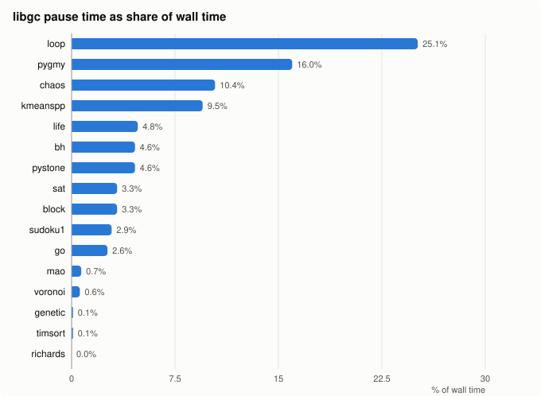
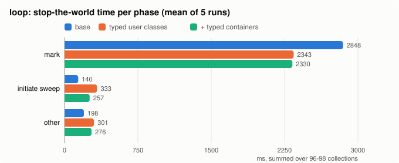
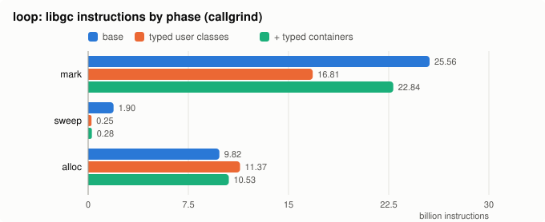
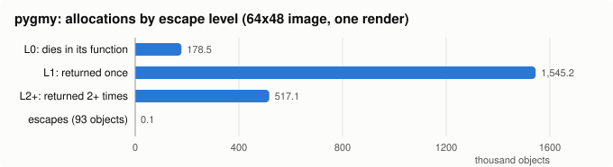

# Typed allocation, escape census and libgc cost

Investigation log, 2026-10-24. Question: can shedskin drop libgc (bdwgc) and
generate its own memory management? This log measures what libgc costs today,
prototypes typed allocation, and sizes escape analysis on one example.

## Summary

- libgc pause time is a median 3.3% of wall time over 16 examples. Four
  examples exceed 9%: loop, pygmy, chaos, kmeanspp.
- Typed allocation cuts loop's mark time by 18%. Typing user classes alone
  gives the full mark saving; typing containers as well cuts wall time 5.2%
  in total, at +15% peak RSS.
- In pygmy, 93 of 2.24 M allocations escape. 8% die in the allocating
  function; 69% die one return later, 23% two or more returns later.
- Collector changes address a few percent of runtime in most programs.
  Escape analysis with inlining could remove nearly all of pygmy's
  allocations; that is an upper bound.

## Setup

- bdwgc v8.2.6, statically linked from `~/.cache/shedskin/src/bdwgc`.
- `shedskin build --build-type Release` (`-O2`). The default build type is
  Debug.
- Linux x86-64, 16 cores. libgc marks effectively single-threaded here: user
  time equals wall time.
- Sizes use binary units: 1 GB = 2^30 bytes, 1 MB = 2^20 bytes.
- `perf` is unavailable (`perf_event_paranoid=4`). Measurements use:
  - `GC_PRINT_STATS=1`: libgc logs each collection's mark and total pause time.
  - callgrind: instruction counts. libgc has debug info, so cost is attributed
    by bdwgc source file (`mark.c`, `reclaim.c`, `malloc.c`, ...).

Pause time excludes the lazy sweep, which runs inside allocation. Instruction
share overstates time share for marking, which is memory-bound. The true GC
share lies between the two.

## libgc cost across examples

| Example | Pause share | Collections | Allocated | Final heap |
|-|-|-|-|-|
| loop | 25.1% | 96 | 13.4 GB | 467 MB |
| pygmy | 16.0% | 4896 | 24.8 GB | 5.8 MB |
| chaos | 10.4% | 3359 | 14.3 GB | 43 MB |
| kmeanspp | 9.5% | 1451 | 6.9 GB | 5.8 MB |
| life | 4.8% | 1596 | 8.4 GB | 5.8 MB |
| bh | 4.6% | 16 | 0.37 GB | 65 MB |
| pystone | 4.6% | 114 | 0.59 GB | 5.8 MB |
| sat | 3.3% | 403 | 2.4 GB | 7.6 MB |
| block | 3.3% | 103 | 0.78 GB | 10 MB |
| sudoku1 | 2.9% | 61 | 0.31 GB | 5.8 MB |
| go | 2.6% | 41 | 0.59 GB | 32 MB |
| mao | 0.7% | 189 | 1.1 GB | 16 MB |
| voronoi | 0.6% | 100 | 0.39 GB | 4.6 MB |
| genetic | 0.1% | 13 | 0.06 GB | 5.8 MB |
| timsort | 0.1% | 19 | 0.57 GB | 140 MB |
| richards | 0.0% | 4 | 0.01 GB | 7.7 MB |

One run each. The sample was chosen by hand; it excludes examples that need
a GUI, an extension module, or arguments.

The heavy examples have two profiles:

- loop keeps about 190 MB live. Each of 96 full collections re-marks it.
- pygmy, chaos and kmeanspp keep little live. They collect every ~5 MB
  allocated, because `GC_set_min_bytes_allocd(4 << 20)` in
  `shedskin/lib/builtin.cpp` sets the minimum.

### callgrind breakdown (loop, go, bh)

| | loop | go | bh |
|-|-|-|-|
| libgc share of instructions | 60.9% | 4.8% | 10.2% |
| mark | 46.9% | 2.3% | 7.2% |
| sweep | 2.5% | 0.3% | 1.7% |
| alloc and other | 11.2% | 1.8% | 1.2% |

`GC_header_cache_miss` counts as mark: `GC_mark_from` calls it.

### `--nogc` is not a lower bound

`--nogc` allocates with `std::allocator` and never frees.

| | loop | go | bh |
|-|-|-|-|
| wall, default (s) | 12.9-13.1 | 2.73-2.77 | 3.67-3.82 |
| wall, `--nogc` (s) | 16.8-17.6 | 2.79-2.87 | 3.45-3.62 |
| peak RSS, default | 508 MB | 39 MB | 84 MB |
| peak RSS, `--nogc` | 14.3 GB | 633 MB | 493 MB |

Faulting in 14 GB of fresh pages costs loop more than collecting does.

### Heap size

Larger heaps mean fewer collections, but not less time:

| | collections | pause | wall | peak RSS |
|-|-|-|-|-|
| loop, default | 96 | 3.3 s | 13.1 s | 509 MB |
| loop, `GC_FREE_SPACE_DIVISOR=1` | 55 | - | 11.5-12.2 s | 800 MB |
| pygmy, default | 4896 | 0.75-0.79 s | 4.6-4.9 s | 11 MB |
| pygmy, `GC_INITIAL_HEAP_SIZE=64M` | 400 | 0.58-0.64 s | 5.8-5.95 s | 74 MB |
| chaos, default | 3359 | 1.05-1.14 s | 9.6-10.5 s | 50 MB |
| chaos, `GC_INITIAL_HEAP_SIZE=64M` | 450 | 0.45 s | 9.7-9.8 s | 72 MB |

pygmy runs 22% slower with the larger heap. Probable cause: an 11 MB heap stays
in cache and a 74 MB heap does not. Cache misses were not measured.

## Typed allocation prototype

bdwgc scans every word of a normal object as a possible pointer. That
includes the vtable and scalar fields. Each candidate costs a range check,
and a header lookup when the value falls inside the heap's address range.

shedskin knows every field's static type, so it can give the collector a
precise layout. The prototype gives each layout a bdwgc object kind
(`GC_new_kind`). The kind carries a `GC_DS_BITMAP` descriptor with one bit
per word; set bits mark words that may hold pointers. A per-kind descriptor
was chosen over `GC_malloc_explicitly_typed`, which stores a descriptor in
every object and adds 8 bytes to each.

The prototype lives in hand-patched generated code and a patched copy of
`shedskin/lib`. The repository is unchanged.

- A header, `ss_typed.hpp`, creates kinds on first allocation. Each class
  has a free list refilled with `GC_generic_malloc_many`.
- User classes: each gets `static void __ss_layout(GC_word &bm)`, which sets
  bits from `offsetof` of each field whose type is not arithmetic or
  `__ss_bool`. Each `__SS_NEW C(...)` becomes placement new on the class's
  allocator.
- Containers: `list`, `set` and `dict` get a class-level `operator new`, so
  library-internal allocations are typed too. The `small_vector` inside
  `list` is private, so its layout is probed on an empty list: the word
  equal to `units.data()` is the buffer pointer, and the inline slots are
  pointers unless the element type is scalar. The boost tables inside `set`
  and `dict` are marked as all pointers.
- bdwgc allows 16 kinds (`MAXOBJKINDS`) and uses 4 itself. Kinds are shared
  by (size, bitmap); when they run out, allocation falls back to the
  conservative NORMAL kind. loop needs 10 kinds: 7 user classes plus 3
  container layouts.

Two variants were measured: "typed" (8 user classes, 15 allocation sites)
and "typed2" (typed plus all `list`, `set` and `dict` objects). Container
buffers stay untyped in both. Output is byte-identical to the untyped build.

### Two bugs found on the way

- Free-list linking. The first free list linked objects through word 0. The
  descriptor marks word 0 (the vtable) as a non-pointer, so the marker kept
  only the list head; the collector reclaimed the rest and handed out the
  same memory twice. Free objects now sit in a scanned array, as
  `__ss_atomic_stacks` in `shedskin/lib/builtin.hpp` already does for
  pointer-free objects.
- List probe. The probe first read each word through a pointer cast and
  found no word equal to `units.data()`. Lists that grew past 4 elements then
  had an untraced heap buffer, and loop's output changed. Reading the words
  with `memcpy` finds the pointer; the likely cause is a strict-aliasing
  violation in the cast.

### Results

Five interleaved runs per variant:

| | base | typed | typed2 |
|-|-|-|-|
| collections | 96 | 97 | 98 |
| mark (ms) | 2820-2902, mean 2848 | 2329-2366, mean 2343 | 2307-2372, mean 2330 |
| initiate sweep, mean (ms) | 140 | 333 | 257 |
| total pause, mean (ms) | 3187 | 2977 | 2863 |
| wall (s) | 12.28-12.67, mean 12.46 | 11.95-12.18, mean 12.07 | 11.78-11.91, mean 11.81 |
| peak RSS (MB) | 509 | 508 | 578-595 |

"other" in the chart is total pause minus mark and initiate sweep.

- Typing user classes cuts mark time 18%. Typing containers adds no further
  mark saving.
- typed2 cuts wall time 5.2% against 3.1% for typed. Most of the extra
  saving comes from a shorter initiate-sweep phase.
- typed2 raises peak RSS by 15%. Mean live data per collection is unchanged
  (97 MB vs 100 MB) and only the peak differs (266 MB vs 222 MB). Probable
  causes, not verified: collections land at different points of loop's
  cycle, or ten kinds leave more partly filled blocks.
- typed moves sweep cost into the pause. Lazy sweep instructions drop 87%
  while initiate-sweep time rises. Probable cause, not verified: segregating
  classes into separate blocks leaves more blocks fully empty, so libgc frees
  them whole at collection time.

- Mark instructions fall 34% for typed while mark time falls 18%. The
  marker still loads every object it scans; only the per-word work goes
  away.
- typed2 executes more mark instructions than typed (22.8 G vs 16.8 G)
  while its native mark time is equal. This is unexplained; collection
  points may differ under valgrind. Trust the native times.
- The base callgrind total (68.5 G instructions) differs from the earlier
  CMake build's (79.2 G), while native GC statistics match exactly. Compare
  callgrind numbers only within this table.

### Limits

- The 16-kind cap needs kind sharing. A program with many distinct layouts
  falls back to conservative marking for the rest, or needs a rebuilt bdwgc.
- Container buffers vary in size, which a fixed bitmap cannot describe.
  Typing them needs a mark procedure (`GC_DS_PROC`).
- `offsetof` on a class with a vtable is conditionally supported. It works on
  GCC and Clang and breaks with virtual inheritance.
- The `list` layout comes from probing boost internals at run time. A boost
  upgrade that stores the buffer pointer differently breaks it silently;
  a real implementation needs a check at startup.
- Placement new on the per-class allocator cannot be elided. Generated code
  uses an elidable `::new` (`__SS_ELIDE_NEW`) today.

## Escape census (pygmy)

pygmy is a ray tracer. Its 16% GC share comes from short-lived objects: the
heap stays at 5.8 MB while it allocates 24.8 GB.

### Method

pygmy runs under CPython 3.14 with an instrumented AST. Every tuple, list,
dict and set display, call and binop result passes through a tracking
function. It registers new user-class instances, tuples, lists, dicts, sets
and strings with the current frame. Floats, ints and bools are skipped, as
shedskin stores them by value.

A profiler hook classifies a frame's objects when the frame returns.
CPython reference counts are exact, so an object is reachable from outside
the frame iff its refcount exceeds the references from the frame's locals,
from other objects the frame allocated, and from the return value. Returned
objects move to the caller and are classified again there.

| Level | Meaning |
|-|-|
| L0 | unreachable when the allocating function returns |
| L1 | returned once, unreachable when the caller returns |
| L2+ | returned two or more times before becoming unreachable |
| escapes | reachable from the heap or globals at some return |

The tracker holds every object until its frame returns. An object that
escapes and becomes unreachable again before the return counts as
non-escaping, so the census is an upper bound for a static analysis. A
self-test covers 9 cases (locals, containers, one- and two-level returns,
global and attribute stores, tuple unpacking).

The run uses a 64x48 image and one render; the shedskin benchmark renders
320x240 ten times. Scaled by 250, the census predicts 25.0 GB at 48 bytes
per object (a shedskin `vec` or `line` occupies 48 bytes); libgc logs
24.8 GB.

### Results

| type | L0 | L1 | L2+ | escapes | total |
|-|-|-|-|-|-|
| vec | 125,699 | 1,058,160 | 517,088 | 16 | 1,700,963 |
| tuple | 1 | 482,565 | 0 | 0 | 482,566 |
| line | 46,908 | 0 | 0 | 0 | 46,908 |
| Shaderinfo | 5,748 | 0 | 0 | 0 | 5,748 |
| str | 144 | 4,464 | 0 | 49 | 4,657 |
| other | 49 | 0 | 0 | 28 | 77 |
| total | 178,549 (8.0%) | 1,545,189 (69.0%) | 517,088 (23.1%) | 93 | 2,240,919 |

Top allocation sites:

| allocating function, type | L0 | L1 | L2+ |
|-|-|-|-|
| `sphere.intersect`, vec | 6,722 | 910,026 | 0 |
| `vec.__sub__`, vec | 0 | 2,978 | 495,686 |
| `sphere.intersect`, tuple | 0 | 458,374 | 0 |
| `vec.mag`, vec | 70,480 | 0 | 0 |
| `vec.__mul__`, vec | 0 | 56,778 | 7,540 |
| `vec.__add__`, vec | 0 | 43,001 | 13,862 |
| `plane.intersect`, vec | 0 | 39,566 | 0 |
| `shader.isoccluded`, line | 32,070 | 0 | 0 |
| `shader.doocclusion`, vec | 32,070 | 0 | 0 |

- `sphere.intersect` builds `pos` and `norm`, returns them in a tuple, and
  the caller unpacks and drops all three: 1.37 M objects, all L1.
- `vec.__sub__` results pass through `line.vec()` before `intersect` drops
  them: 0.5 M objects at L2+.
- Escape analysis without inlining reaches at most 8% of allocations.
  Inlining one level reaches 77%; inlining two or more levels, or returning
  small objects by value, reaches the rest.
- `vec.norm()` mutates its object in place. Stack allocation keeps object
  identity, so the mutation stays correct. Converting `vec` to a value type
  would not keep identity, and would need proof that no mutated object is
  aliased.

## Reproducing

- Escape census: `python3.14 scripts/escape_census.py examples/pygmy/pygmy.py 64 48`.
  Run it from a scratch directory, as pygmy writes `pygmy.ppm` to the
  current directory. pygmy's occlusion sampling is unseeded, so counts vary
  by about 0.01% between runs. `--selftest` runs the calibration and the 9
  cases alone; `tests/unit/test_escape_census.py` runs it under `make test`.
- Charts: `python3 scripts/type_alloc_charts.py docs/dev/type-alloc-charts.json`
  regenerates the SVGs from the numbers in that file.
- The typed allocation prototype is not in the repository. It consists of
  the per-layout kinds, free lists and layout functions described above,
  added to generated code and to `list`, `set` and `dict`.

## Conclusions

- Typed allocation is a modest win: 18% of mark time, 3-5% of wall time on
  the most GC-bound example. It brings kind-cap, layout-probing and RSS
  costs.
- For allocation-heavy programs such as pygmy, the cost lies in allocation
  volume, not in the collector. A static escape analysis combined with
  inlining of small methods addresses it directly. The census bounds its
  reach at nearly all of pygmy's allocations; the reach of a real analysis
  is unmeasured.
- Neither result supports dropping libgc: programs that keep data live
  across calls (loop) still need a collector.
